# Finans — sistem incelemesi ve geliştirme sırası

İnceleme: 7 Eylül 2026. Kapsam: yerel kod, kayıtlı raporlar/tahminler, tüm mevcut testler, yerel panel, canlı site ve GitHub Actions çalışma kayıtları. Bu belge bir yatırım önerisi veya doğrulanmış strateji performansı değildir; ürün ve araştırma sistemi değerlendirmesidir.

## Karar

Ürün; ABD, BIST ve kripto verisini toplayan, teknik puan üreten, ATR işlem planı çıkaran, karar günlüğü tutan ve makro yorum ekleyen bir kişisel araştırma terminali. Hedef anlaşılır. Ancak sayısal görünen çıktılarının bir kısmı ölçülmüş tahmin gücüne dayanmıyor. Daha güçlü model, bu eksikliği kendiliğinden çözmez.

Öncelik: veri ve yayın bütünlüğü → haber olay kayıtları → önceden kaydedilmiş tahminler → sonuç ölçümü → ölçülen katkıya göre sinyal. Yeni ekran ve gösterge eklemek şu anda düşük öncelikli.

## Doğrulanan durum

- Canlı adres GitHub repository homepage alanından bulundu: https://finans-dashboard-iota.vercel.app/ . Tarayıcıda açıldı.
- 7 Eylül dahil son beş GitHub Actions veri güncellemesi başarılı. Son incelenen çalışma: https://github.com/009tuna/Finans/actions/runs/34119824632 . `event=schedule`, başlangıç 12:03:42 UTC, bitiş 12:04:08 UTC. Yerel workflow 06:00 UTC yazıyor. Uzak workflow sürümü ve scheduler gecikmesi ayrıştırılmadan altı saatlik farkın nedeni kesinleştirilemez.
- Aynı günkü workflow logu ipucu arşivleme adımında hâlâ 18 Haziran 2026 tarihini kullanıyor. Başarılı çalışma rozeti, güncel AI içerik üretildiğinin kanıtı değil.
- Aynı logun veri özeti: ABD 12, BIST 100, kripto 12, `hata:9`. Resolver: 2 yeni kapanış (1 hedef, 1 stop), 35 açık. Takvim: 0 ekonomik olay, 18 bilanço, 5 şirket haberi. Dolayısıyla veri pipeline'ı çalışıyor ama eksiksiz değil. Uzak toplam kapanış/isabet oranı bu özetle hesaplanamaz.
- Tarayıcıda piyasa verisi 13–16 dakika önce üretilmiş olarak göründü; 124 varlık gösteriliyor. AI raporu bekleniyor mesajı vardı. Doğrudan Supabase/yerel API okumaları 15–20 saniyelik deneme sınırını aştı; bu nedenle güncel bulut tahmin sayısını doğrulayamadım. Tarayıcı daha sonra veri yükleyebildi. Kesin kesinti veya Supabase projesi durdurulmuş teşhisi koymuyorum.
- Canlı Günlük Rapor sekmesi tamamen yüklendi: `2026-09-07`, 124 varlık, 39 AL, AI bekleniyor, 124 makro baskı ve 143 süresi dolan bileşen. Raporda üretim yaşı 8 saat; üst çubukta fiyat verisi yaşı 16 dakika. Genel bakış AGHOL için 92 gösterirken raporun teknik fırsat listesi 75 gösterdi. Bunlar aynı bilgi kesitinden gelmiyor; tek bir güncel karar gibi sunulmamalı.
- `npm test` içindeki 16 test dosyasının tamamı geçti, çıkış kodu 0.
- Yerel `data/latest.json`: 8 Haziran. `data/report/base.json`: 28 Haziran üretimi ama `date=2026-06-08`. Yerel AI raporu: 25 Haziran. Bu dosyalar canlı snapshot yerine kullanılamaz.
- Yerel journal: 60 tahmin; 31 açık, 5 hedef, 24 stop. Kapanan 29 kaydın tamamı BIST. Hedef isabeti %17,2; kayıtlı basit sonuçların aritmetik ortalaması %-3,63; kayıtlı fiyatlardan hesaplanan ortalama yaklaşık -0,483R. Bu rakamlar Haziran yerel örneklemini tarif eder; güncel veya para ağırlıklı portföy getirisi değildir. Maliyet, gerçek gerçekleşme, bağımsızlık ve açık pozisyonlar nedeniyle genellenemez.

## Öncelikli bulgular

| Öncelik | Kanıt | Sonuç ve gerekli düzeltme |
|---|---|---|
| P0 | `src/signal-overlay.js:138`: şirket haberi başlığında `lawsuit` varsa +2; diğer haberler de +1 alıyor. | Olumsuz haberin teknik puanı artırması mümkün. Haber varlığı, yön, belirsizlik ve işlem kararı ayrılmalı. Doğrulanmamış yön nötr olmalı. |
| P0 | `src/signal-overlay.js:72`: rapor yaşını okumadan metne `nowIso` ve +36 saat veriyor. `calendar.js` haberde `datetime` üretirken overlay `news.date` okuyor. | Eski yorum ve eski haber yeni sinyal olarak canlanabiliyor. Orijinal yayın/erişim saatleri korunmalı; gelecekteki ve geçersiz tarihler reddedilmeli. |
| P0 | `.github/workflows/daily-refresh.yml` AI üretmiyor. `daily-update.bat:24` Claude çağırıyor; `push-ai-report.js` adımı yok. Base rapor AI'dan önce oluşturuluyor. | Fiyat/temel rapor ve AI yayını farklı zincirlerde. Tek `runId`, snapshot sürümü ve yayın manifestiyle uçtan uca akış kurulmalı. |
| P0 | `api/journal.js:14` / `:20` yalnız dosya okuyor/yazıyor; yerel sunucu async Supabase yolunu kullanıyor. POST yetki kontrolü yok. | Bulut ve yerel tahmin günlüğü farklılaşabilir; Vercel'de dosya yazımı kalıcı veri katmanı değildir. Ortak DB repository, kimlik doğrulama, şema doğrulama, sürüm kontrolü ve çakışma koruması gerekli. Bu incelemede uzaktaki kayıtları değiştiren istek yapılmadı. |
| P1 | `src/forecast.js:126` farklı para birimlerindeki `amount * currentPrice` değerlerini topluyor; `public/app.js:2670` BIST fiyatını TRY gönderiyor. | Karma portföy Monte Carlo başlangıç değeri ve ağırlıkları birim olarak yanlış olabilir. Tek baz para birimi ve tarihsel kur getirisi zorunlu. |
| P1 | `src/forecast.js:95` eksik geçmiş günlerini sonraki günün fiyatıyla dolduruyor. 252 yıllıklandırma ve 365 ufuk birlikte kullanılıyor. | Gelecek fiyat geçmişe sızıyor; kripto/hisse gün takvimleri karışıyor. Piyasa takvimiyle nedensel hizalama ve ortak zaman tanımı gerekli. |
| P1 | `src/backtest-engine.js:62` aynı gün kapanışını içeren skor; `:77` aynı kapanıştan işlem. Stop/target yalnız kapanış değişimiyle test ediliyor. | Gerçekleşme varsayımı iyimser; gün içi stoplar kaçabilir. Sinyal t kapanışı → t+1 açılışı, açılış boşluğu, OHLC sıralama belirsizliği ve maliyet uygulanmalı. |
| P1 | Backtest `scoreAsset(ind, null, market)` kullanıyor; canlı ABD skorunda analist verisi var. Isınma 50 gün, bazı göstergeler 200 gün istiyor. | Test edilen strateji ile canlı strateji aynı değil. Özellik/sürüm parity ve point-in-time temel veri gerekli. Yarı dönem getirilerini ayırmak gerçek walk-forward doğrulama değildir. |
| P1 | `routines/daily-report-prompt.md` en az 4–5 sinyal, 5 olay ve sayısal `myCall` istiyor. | Kanıt yokken bile içerik ve hassasiyet üretme baskısı var. Sıfır sinyal ve tahminden kaçınma geçerli sonuç olmalı. |
| P1 | `src/report.js:94` en çok 8 ABD sembolü; `calendar.js` sembol başına tek haber. Haber sorgusu bugün–6 gün sonrası. `Promise.all` takvim hatasında bütün başarılı sonuçları kaybedebilir. | Gece/hafta sonu haberleri, BIST KAP ve kripto olayları kapsam dışı kalabiliyor. Haber için geçmiş pencere, takvim için gelecek pencere; kaynak bazında bağımsız hata yönetimi gerekli. |
| P1 | `src/report.js` Finnhub tokenını config'den okuyor, fetch-all'daki env override yok. DB okuma hatasında eski yerel snapshot'a düşüyor. Yayın yazma hatasını yakalayıp tamamlanabiliyor. | Eski veriyle başarılı rapor görünümü mümkün. Kaynak durumu ve fallback açıkça taşınmalı; zorunlu aşama başarısızsa süreç başarısız bitmeli. |
| P1 | `src/decision-auditor.js` 5 örnekle kural değiştiriyor; 20 örneğe doğrudan 0,85 confidence atıyor. | Confidence ölçülmüş olasılık değil. Aynı rejimdeki korelasyonlu BIST tahminleri bağımsız örnek gibi ele alınmamalı. Kalibrasyon dış örneklemde sınanmalı. |
| P2 | Ana ekranda AI eksikliği, “124 baskı / 0 destek”, “Risk: Düşük” ve “karar kalitesi 91/100” birlikte göründü. `public/insights.js:228` risk özetine AI kapsamını katmıyor. | Veri yeterliliği, teknik kalite, makro görüş ve yatırım riski farklı kavramlar. Bilinmeyen risk düşük risk olarak sunulmamalı; üç ayrı durum gösterilmeli. |
| P2 | Canlı Günlük Rapor üç sütununda eksik içerik uzun boş alanlar bırakıyor; “Pazar yorumu bekleniyor” dar bir sütunda kelime kelime kırılıyor. Aynı haberler aşağıda yeniden listeleniyor. | Veri eksikliğinde bütün kartı yüksek tutma. Tek eksiklik satırı, okunabilir metin genişliği, tek haber listesi ve olayın Türkçe etkisi kullanılmalı. |
| P2 | Yerel `server.js` backtest fonksiyonunu import ediyor ama `/api/backtest` route'u yok; Vercel route'u var. | Yerel/prod işlev ayrışması. Aynı route handler'ları iki ortamda kullanmak gerekli. |

İlk iki P0 bulgu bellek içindeki sentetik örnekle yeniden üretildi: “Company faces lawsuit over accounting fraud” haberi +2 aldı. 1 Haziran tarihli “likidite destegi” yorumu 7 Eylül tarihli, 8 Eylül'e kadar geçerli +1 makro sinyale dönüştü. Kullanıcı verisi değiştirilmedi.

## Üründe korunacak temel

Deterministik indikatörler, rejime göre farklı ağırlıklar, ATR planı, teknik ve makro skorların ayrı saklanması, maliyet modülü, tahmin günlüğü ve test altyapısı korunmalı. Baştan yazmak gereksiz. Fakat “CFO”, “komite”, “tearsheet” terimleri kanıt kalitesini yükseltmiyor; bireysel çok piyasada araştırma amacına uygun sade bir dil gerekli.

Ana ekranda şu sorular yeterli: Ne değişti? Hangi varlığı neden etkiliyor? Kanıt ne kadar güncel? Ne olursa görüş değişir? İşlem için hangi teyit eksik? Ayrıntılı grafikler ve eğitim ikinci okumada kalmalı. “Günlük rapor ana ekranın merkezinde” gibi ürünü tarif eden başlık yerine günün gerçek bulgusu yazılmalı.

## Haber ve forecast mimarisi

```mermaid
flowchart LR
  A[Kaynak ve zaman damgası] --> B[Aynı olayın haberlerini birleştir]
  B --> C[Doğrulanmış olgular ve piyasa beklentisi]
  C --> D[Olay sonucu tahmini]
  D --> E[Sonuca koşullu piyasa senaryoları]
  E --> F[Kanıt ve işlem uygunluğu kontrolü]
  F --> G[Versiyonlu yayın]
  G --> H[Vadesinde sonuç ölçümü]
  H --> I[Model ve temel yöntem karşılaştırması]
```

### Üç farklı çıktı

1. **Olay sonucu:** Örneğin çekirdek enflasyon için konsensüs, önceki ilk açıklama, revize önceki değer, model medyanı ve belirsizlik aralığı. Nokta tahmini tek başına yetersiz.
2. **Koşullu piyasa tepkisi:** Beklentinin altında/çevresinde/üstünde veri gelirse 30 dakika, seans kapanışı ve 5 işlem günü tepkisi. Pozisyonlanma, tahvil, döviz ve sektör ayrımıyla gerekçe.
3. **İşlem adayı:** Doğrulanmış fiyat, likidite, maliyet, katalizör saati ve bozulma koşulu uygunsa aday. Her haber işlem adayı üretmez. “İzle / teyit bekle / yeterli kanıt yok” birinci sınıf çıktılardır.

Model güveni ile veri güveni ayrılmalı. Kaynağın kesin olması, piyasa tepkisinin kesin olduğu anlamına gelmez. Aynı haberi üç sitenin yayımlaması üç bağımsız kanıt değildir. Metinden doğrudan +8/-8 puana geçiş kaldırılmalı; puan katkısı ancak gölge değerlendirmede fayda gösterirse etkinleşmeli.

### Piyasa bazında araştırma

| Piyasa | Gerekli girdiler | Asıl araştırma sorusu |
|---|---|---|
| ABD | Resmî makro açıklamalar, konsensüs vintage'ı, SEC/şirket yatırımcı ilişkileri, marj ve rehberlik, tahvil/dolar/sector fiyatları | İyi haber beklentiden de iyi mi; büyüme faydası iskonto oranı baskısını aşıyor mu? |
| BIST | KAP, finansal tablolar, TCMB/TÜİK, net döviz pozisyonu, borç vadesi, sektör, hacim ve likidite | Kur/faiz değişiminin şirket kârına ve USD bazlı getiriye etkisi ne; nominal büyümenin ne kadarı ekonomik iyileşme? |
| Kripto | Resmî protokol duyuruları, ETF ihraççı verileri, fonlama, açık pozisyon, spot hacim, stablecoin ve token açılışları | Hareket yeni spot talepten mi kaldıraçtan mı geliyor; arz takvimi bunu tersine çevirebilir mi? |
| Makro referanslar | Faiz eğrisi, dolar, altın/petrol ve ana endeksler | Diğer piyasalara hangi aktarım kanalıyla etki ediyor? İlk aşamada her birine ayrı al/sat sistemi kurmak gereksiz. |

SEC şirket başvuruları ve XBRL için belgelenmiş API sunuyor: [SEC EDGAR](https://www.sec.gov/search-filings/edgar-application-programming-interfaces). BIST şirket olayları için [KAP](https://www.kap.org.tr/en), politika takvimi için [TCMB](https://www.tcmb.gov.tr/wps/wcm/connect/TR/TCMB%2BTR/Main%2BMenu/Duyurular/Takvim) temel kaynak olarak kullanılmalı. Bunların veri erişimi/lisans ve sağlayıcı kapsamı uygulama sırasında ayrıca doğrulanmalı; mevcut bağlantılar bütün alanların ücretsiz API ile alınabileceği iddiası değildir.

Geçmiş forecast ölçerken bugünkü revize veriyle geçmiş bilgi seti karıştırılmamalı. [FRED real-time periods](https://fred.stlouisfed.org/docs/api/fred/realtime_period.html) geçmişte neyin bilindiğini sorgulamak için uygun yaklaşımı belgeliyor.

## Örnek: Astra'dan beklediğim muhakeme

Aşağıdaki sayılar tamamen sentetik; güncel enflasyon tahmini veya yatırım sinyali değildir.

“Konsensüs çekirdek aylık enflasyon için %0,3; sonuç %0,2 geldi. İlk okuma faiz baskısının hafiflemesi. Ancak riskli varlıklar için otomatik AL üretmiyorum. Önce sürprizin yuvarlamadan mı, yaygın dezenflasyondan mı geldiğini, önceki ay revizyonunu ve büyüme bileşenlerini kontrol ederim. ABD iki yıllık getirisi ve dolar düşüyor, endeks yükselişi genele yayılıyorsa iskonto oranı senaryosu güçlenir. Getiriler düşerken banka/sanayi hisseleri geriliyor ve kredi risk göstergeleri bozuluyorsa büyüme korkusu öne çıkabilir. BTC yükselişi açık pozisyon sıçramasıyla, zayıf spot hacimle geliyorsa ilk hareketi kalıcı talep saymam. BIST'te kur duyarlılığı ve şirketin döviz borcu farklı olduğu için aynı haber bankaya, ihracatçıya ve ithalatçıya aynı puanı vermez.”

Bu analiz, sonuç açıklandıktan sonra yazılıyorsa forecast değil olay-sonrası değerlendirmedir. Forecast önceden dondurulmalı. Kendi olasılığımız için dayanak yoksa yüzde uydurmak yerine “kalibre edilmemiş görüş / tahmin yok” yazılmalı.

## Ölçüm ve öğrenme

- Makro nokta tahmini: aynı bilgi kesitindeki konsensüse karşı MAE; tahmin aralıkları için kapsama ve genişlik. Veri sonuçları ilk açıklama ve revizyon olarak ayrı saklanmalı.
- Olasılıklı olaylar: Brier skoru ve olasılık dilimleri için gerçekleşme oranı. “%70 dediğimiz olaylar ne sıklıkla oldu?” sorusu.
- Piyasa tepkisi: vade tanımı ve benchmark önceden dondurulmuş yön/abnormal getiri. Aynı olayın farklı hisselerini bağımsız olay diye saymama.
- İşlem adayı: maliyet sonrası R, profit factor, maksimum düşüş, turnover, benchmark ve risk bütçesi. Basit isabet oranı tek başına karar ölçütü değil.
- Karşılaştırmalar: yalnız teknik, yalnız haber, teknik+haber. Astra'nın ek katkısı basit konsensüs ve mevcut stratejiye karşı ölçülmeli.
- Küçük örneklemde otomatik skor ayarı yok. Önceden belirlenmiş değerlendirme dönemi, olay/piyasa gruplaması, güven aralıkları ve ayrı test dönemi gerekli. Sabit bir “30 gün geçti, model kanıtlandı” kuralı olmamalı.
- Geriye dönük açık internetle yapılan LLM denemesinde sonradan öğrenilmiş sonuçlar sızabilir. En güçlü kanıt, bugünden itibaren değiştirilemeyen kayıtlara yazılan ileriye dönük gölge tahminlerdir.

## Otomasyon hedefi

Tek orkestrasyon: veri al → kaynak kalitesini kontrol et → yeni olayları birleştir → vadesi dolan tahminleri çöz → modele kanıt paketini ver → şemayı ve sayıları doğrula → tutarlı base+AI+overlay sürümünü yayımla → yayınlanan API'yi geri okuyarak doğrula.

Türkiye ve ABD için ilgili piyasanın yerel takvimine göre seans öncesi/kapanış; kripto için hafta sonu dahil ayrı döngü. Makro olaylarda resmî açıklama zamanı baz alınmalı. Bütün ağır model işini her fiyat yenilemesinde çalıştırmak gereksiz: yeni olay veya maddi değişiklik yoksa önceki analizi koru, saatini yenileyerek yeniymiş gibi gösterme.

GitHub zamanlı workflow gecikebilir; açıklama dakikasına duyarlı sistem için tek zaman garantisi olarak kullanılmamalı. Bu davranış [GitHub schedule belgelerinde](https://docs.github.com/en/actions/reference/workflows-and-actions/events-that-trigger-workflows#schedule) açıklanıyor. Altyapı seçimi maliyet, gecikme hedefi ve veri lisanslarına göre yapılmalı.

Çalışma kaydı: aşama, başlangıç/bitiş, veri yaşları, eksik kaynaklar, kullanılan model ve prompt sürümü, maliyet, tekrar sayısı, yayın kimliği. Aynı iş yeniden çalıştığında mükerrer tahmin veya yayın üretmemeli. Başarısız kaynak bütün piyasaları düşürmemeli; ancak kritik kanıt eksikse ilgili piyasanın yön sinyali durmalı.

Bildirim gerekiyorsa anlamlı yeni olay, tez bozulması, yayın hatası veya gerekli kullanıcı aksiyonuyla sınırlanmalı. Bu inceleme yeni zamanlama veya haricî mesaj akışı kurmadı; çalışan veri otomasyonuna dokunulmadı.

## Uygulama sırası ve kabul koşulları

1. **Bütünlüğü düzelt:** stale/gelecek zaman testleri, haberin yönsüzlük varsayılanı, ortak journal DB, yetkilendirme, AI yayın adımı, explicit hata durumu. Kabul: eski haber canlı sinyal olamaz; dosya/bulut günlüğü ayrışmaz; API'ye geri okunan rapor aynı runId taşır.
2. **Araştırma kaydı kur:** `sources`, `events`, `claims`, `forecasts`, `outcomes`, `analysis_runs` tabloları; idempotent kaynak alımı ve denetlenebilir sürümler. Kabul: her maddi iddia bir kaynağa, her forecast bir çözüm kuralına bağlıdır.
3. **Astra'yı gölge çalıştır:** önce yüksek etkili ABD makro olayları, BIST KAP/TCMB ve BTC/ETH. Diğer sembolleri temel fiyat izleme düzeyinde tut. Kabul: makro tahmin ile fiyat tepkisi ayrı ölçülür; sonuç sonradan değiştirilemez; kanıt yetersizliği doğru biçimde yayımlanır.
4. **Simülasyonu düzelt ve karşılaştır:** tek para birimi, seans takvimi, sonraki açılıştan işlem, maliyet, özellik parity, point-in-time veriler. Kabul: deterministik test fixture'ları ve ayrı değerlendirme dönemi aynı davranışı doğrular.
5. **Karar ekranını sadeleştir:** bugün değişen 3–5 anlamlı olay, etkilenen varlıklar, tez/karşı tez, güvenin dayanağı, geçerlilik, gereken teyit. Kanıtlanan model katkısı kadar puan/uyarı etkinleştir.

Bu sıranın ilk basamağını atlayıp modeli değiştirmek, hatalı sisteme daha ikna edici açıklamalar ekleme riski taşır.
