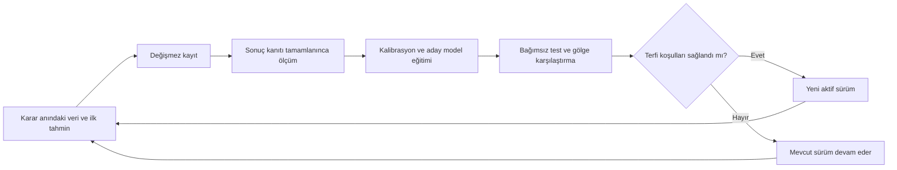

# Finans: kümülatif öğrenme önerisi

Tarih: 4 Ekim 2026. Durum: mevcut kod incelemesine ve birincil araştırmalara dayanan mimari öneri. Ürün kodu/model/işlem defteri değiştirilmedi; yeni öğrenme döngüsü uygulanmadı veya ölçülmedi. Bu belge uygulama planı veya onaylanmış strateji sürümü değildir.

## Mevcut kodda gerçekten ne var?

- `src/decision-journal.js:74`: ilk sinyalin fiyatları, puanı, kaynağı ve strateji sürümü kaydediliyor; aynı varlığın açık tahmini varken yenisi engelleniyor. Tam özellik/veri kesiti henüz bu kayda alınmıyor.
- `src/decision-auditor.js:171`: kapanmış sonuçların piyasa/etiket/puan grubundan ±1/±2 puan önerisi çıkarılıyor. `:207` bu öneriyi `proposal_only` olarak, güveni `heuristic-not-calibrated` olarak işaretliyor. Bu sayısal model eğitimi değildir.
- `src/signal-overlay.js:195`: tarihsel toplu kazanma oranı aktif kalibrasyon yapmıyor. `:201` öğrenme bileşeni boş liste döndürüyor. İncelenen bu akışta öneriler sinyal puanını otomatik değiştirmiyor.
- `src/macro-calibration.js:5`: en az 12 eğitim ve 3 ayrı test olayıyla geçmiş ortalama hatasını düzelten aday karşılaştırması var. İlk açıklama, kaynak kanıtı, zaman sınırı ve yinelenen dönemler kontrol ediliyor. `:298` çıkan düzeltme inceleme önerisi; otomatik aktive edilmiyor. Bu sayılar mevcut mühendislik eşikleri; yeterli istatistiksel kanıt garantisi değil.
- `src/intelligence-context.js`: dondurulmuş makro tahminleri ve sonuç özetleri açıklama bağlamına giriyor. Bağlama geçmiş kayıt vermek, temel LLM ağırlıklarını yeniden eğitmek değildir.
- `src/decision-auditor.js:82`: bazı sonuç açıklamaları kayıptan “sinyal gecikti veya momentum teyidi yetersiz” çıkarıyor. Yalnız sonuç bu nedeni kanıtlamaz. Bu ifadeler ölçülmüş bulgu yerine test edilecek hipotez olarak tutulmalı.

Sonuç: kayıt, audit, yöntem bazlı makro ölçüm ve kalibrasyon önerileri bir başlangıç sağlıyor. Sürümlü veri seti → eğitim → bağımsız değerlendirme → gölge model → aktif sürüm döngüsü henüz incelenen akışta kurulmuş değil.

## Ortak öğrenme döngüsü

Veri biriktirme, performans izleme ve aday eğitimi otomatik olabilir. Aktif modele geçiş önceden belirlenen değerlendirme koşullarına bağlı olur. Her yeni sürümün eğitim kesiti, özellik şeması, parametreleri, kod hash'i ve test sonucu kaydedilir. Aktif model eski tahminleri yeniden yazmaz.

## Üç ayrı öğrenme hedefi

| Hedef | Biriktirilecek kanıt | Öğrenilecek ve ölçülecek şey |
| --- | --- | --- |
| Varlık/sinyal seçimi | Karar anındaki trend, göreli güç, oynaklık, teyitli seviyeler, likidite, piyasa durumu, aday/reddetme nedeni | 90/180 takvim günü ileri getiri ve benchmark farkı; aynı kurallarla yürütülen stratejinin net beklentisi. Özellikler, yalnız mevcut bilgiyle hazırlanır. |
| İşlem planı/yürütme | Başlangıç planı, gerçek giriş uygunluğu, gözlenen açılış, maliyet, gap, stop/çıkış olayları ve fiyat yolu | Giriş gecikmesi, net sonuç, azami olumlu/olumsuz hareket, tutuş süresi. Aday ve gerçekleşmiş işlem ayrı; veri boşluğu zarar olarak etiketlenmez. |
| Makro tahmin | Olay/metric/unit, yayımlanma takvimi, bilgi kesiti, ilk tahmin/aralık, konsensüs varsa tarihli kanıtı, açıklanan ilk değer, sonraki revizyonlar | Yöntem bazında sistematik yüksek/düşük tahmin, mutlak hata, aralık kapsaması ve genişliği. Ekonomik veriyi doğru tahmin etme ile varlığın fiyat tepkisini doğru tahmin etme ayrı hedeflerdir. |

NFP, CPI aylık ve CPI yıllık farklı hedeflerdir; ham hataları tek ortalamada birleştirilmez. Aynı olay için her gün yazılan yorumlar ek bağımsız eğitim/test sonucu sayılmaz. İlk puanlanacak tahmin sürümü ve tahminin açıklamaya uzaklığı ayrıca belirlenir. Sonraki görüşler ilk tahminin üstüne yazılmaz.

## Kümülatif bilgi üç biçimde kullanılabilir

1. **Ölçülebilir istatistik hafızası:** bütün geçerli sonuçlar korunur; yöntem/pazar/ufuk/sürüm bazında hata ve net performans hesaplanır. Küçük alt gruplar genel sonuçla birlikte değerlendirilir; beş benzer işlemden evrensel kural çıkarılmaz. Aday/reddedilen varlık kesitleri de tutulur. Sonraki fiyatları araştırma etiketidir; gerçekleştirilmemiş alış değildir.
2. **Geçmiş örnek hafızası:** karar anında sonucu zaten bilinen benzer örnekler modele kanıt referanslarıyla sunulur. Aynı olayın yinelenen haberleri tek olaya bağlanır. LLM, kaynaklı örneklerden açıklama üretebilir; hafızaya konmuş metin, eğitilmiş sayısal model veya nedensellik kanıtı yerine geçmez.
3. **Model/kalibrasyon öğrenmesi:** basit bias düzeltmesi, belirsizlik aralığı veya özellik ağırlıkları ayrı aday sürüm olarak eğitilir. Sonrasında hafif bir sayısal sıralama modeli denenebilir. Temel LLM fine-tuning ilk ihtiyaç değil; ekonomik faydası bu aşamalardan ayrı değerlendirilir.

Kalibrasyon örneği, varsayımsal: “%70 olasılık” verilen çok sayıdaki bağımsız uygun tahminin gerçekleşme oranı %50 civarındaysa model aşırı emin olabilir. Bunun cevabı yalnız puanı azaltmak değildir; olasılık tanımı, veri kalitesi, dönem değişimi ve belirsizlik ölçülerek yeni kalibrasyon bağımsız dönemde denenir. Teknik puan doğrudan olasılık değildir.

[Gneiting–Raftery'nin proper scoring çalışması](https://sites.stat.washington.edu/people/raftery/Research/PDF/Gneiting2007jasa.pdf), olasılık ve dağılım tahminlerini uygun kayıp fonksiyonlarıyla değerlendirmenin temelini veriyor. Tanımlı ikili sonuçta Brier/log loss, dağılımda CRPS, aralıkta kapsama ile genişliği birlikte cezalandıran interval score kullanılabilir. Bunlar tek başına kârlılık ölçütü değildir.

## Zamanla değişen piyasaya uyum

Geçmişin tamamını denetim için saklayalım. Yeni tahminlerde kullanılacak örneklerin ağırlığını ise eski ve yakın döneme ilişkin rakip politikalarla test edelim. Yakın geçmişe ne kadar ağırlık verileceği sonucun sonunu görerek seçilmesin. Pazarlar arası aktarım ancak ayrı yerel doğrulamayla kabul edilsin.

Hata, kalibrasyon, maliyet ve özellik dağılımındaki değişim düzenli ölçülsün. Bozulma yeni eğitim adayını tetikleyebilir; modelin güveni/pozisyon riskini azaltan veya tahminden kaçınan davranışlar da sürümlü politika olarak sınansın. Piyasa değiştiğinde eski veri hâlâ kayıtta kalır; aktif tahmine katkısı değişebilir.

[Gibbs–Candès, JMLR 2024](https://jmlr.org/papers/v25/22-1218.html), dağılım değişimine uyum sağlayan tahmin aralıkları için yöntem sunuyor; uygulamalarından biri hisse piyasası volatilitesi. Bunu aralık kalibrasyonuna aday olarak değerlendirebiliriz. Sonuç, her olay/pazar/rejimde koşullu kapsama veya işlem kârı garantisi değildir.

## Eğitim ve terfi sözleşmesi

- Eğitim yalnız kesit tarihinde gözlenmiş ve kanıtı tamamlanmış sonuçlardan oluşur. Açık 180 günlük işlemler tam 180 günlük etiket sayılmaz. Önceden tanımlanmış 30/90 günlük ara hedefler, ayrı öğrenme görevleri olarak sonuçları tamamlandığında kullanılabilir.
- Aynı anda açılan çok sayıda korelasyonlu hisse pozisyonu, aynı sayıda bağımsız deney değildir. Eğitim/test zamanları uzun etiketlerin örtüşmesini temizleyecek şekilde ayrılır. Makro testte bir dönem bir sonuçtur.
- Her adayın eğitim/doğrulama ve son test dönemi ayrılır. Görülmüş test sonuçlarına tekrar tekrar göre ayar yapılırsa o dönem artık final test değildir. Bütün adaylar ve başarısız denemeler saklanır.
- Aday, aktif modelle aynı dönemde gölgede tahmin üretir; aktif sistemin ilk kararlarını veya kayıtlarını etkilemez. Sanal stratejiler aynı kaynak, işlem zamanı, maliyet ve portföy sınırlarını kullanır.
- Terfi ölçütleri önceden kaydedilir: makroda baseline'a göre hata ve kalibrasyon; sinyalde maliyet sonrası net sonuç, düşüş, turnover ve dönemler arası dayanıklılık. Yeterli örneklem, sadece sabit bir işlem sayısı yerine belirsizlik ve veri kapsamıyla değerlendirilir.
- İlk öğrenme sürümü sabit risk sınırları içinde çalışır. Model kendisine başarı tanımını, veri kanıtını veya geçmiş sonucu değiştirme yetkisi vermez. Uygun aday yoksa mevcut sürüm kalır. Sonraki bozulmada geri dönülebilecek eski sürüm korunur.

LLM ile yıllar öncesine dönüp bugün tahmin üretmek özel bir sorun taşır: model gerçek sonucu ön eğitiminde görmüş olabilir. Yalnız “o tarihten sonrasını kullanma” talimatı yeterli kanıt değildir. [Lopez-Lira, Tang, Zhu'nun Aralık 2025 çalışma taslağı](https://arxiv.org/abs/2504.14765v2) bu ezberleme sorununu araştırıyor. Sayısal modeller için zamana uygun tarihsel replay ve yeni LLM tahminleri için ileriye dönük dondurulmuş test ayrı değerlendirilmelidir.

## Öğrenme eğrisi ve ilk geliştirme sırası

Panelde kümülatif ve yakın dönem sonuçlar yan yana gösterilsin: geçerli sonuç sayısı, bekleyen/dışlanan kayıtlar, baseline farkı, hata/net getiri, kalibrasyon, düşüş, belirsizlik, aktif sürüm ve adayın durumu. Aynı görev için önceki sürümle eşzamanlı karşılaştırma olmadan modelin daha iyi öğrendiği söylenmesin. Artan kümülatif getiri, tek başına öğrenme kanıtı değildir. n=0 veya yetersiz kanıtta başarı yüzdesi üretilmesin.

Önceliğim: karar anı özellik/veri kesitini tam saklamak → doğru sonuç ve etiket üretimi → yöntem bazlı küçük kalibrasyon adayları → ortak sürüm/deney kaydı → gölge karşılaştırma → koşullu model terfisi. Günlük veri toplama ile aylık yeni aday değerlendirmesi makul başlangıç iş akışıdır; sonuçlar olgunlaşmadıysa takvim gelmiş olması eğitim veya terfi için yeterli değildir. Bu öneri mevcut otomasyonlara uygulanmadı.
